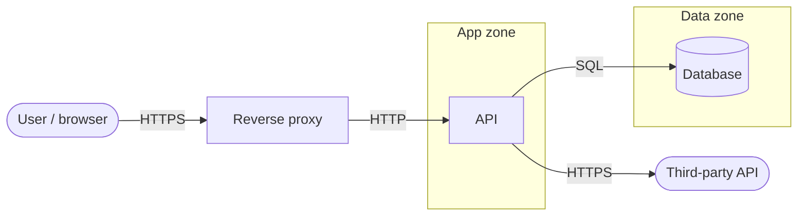

# Threat model: <project>

Date: · Commit: · Reviewed by:

## 1. Data flow diagram

Trust boundaries: internet ↔ proxy · proxy ↔ app · app ↔ data · app ↔ third party

## 2. Threats

| ID | Flow | STRIDE | Threat | Decision | Control (where) |
|---|---|---|---|---|---|
| T-01 | user → proxy | S | | Mitigate | |

## 3. Needs a person

- [ ] Does the diagram match production?
- [ ] Business threats not visible in code:
